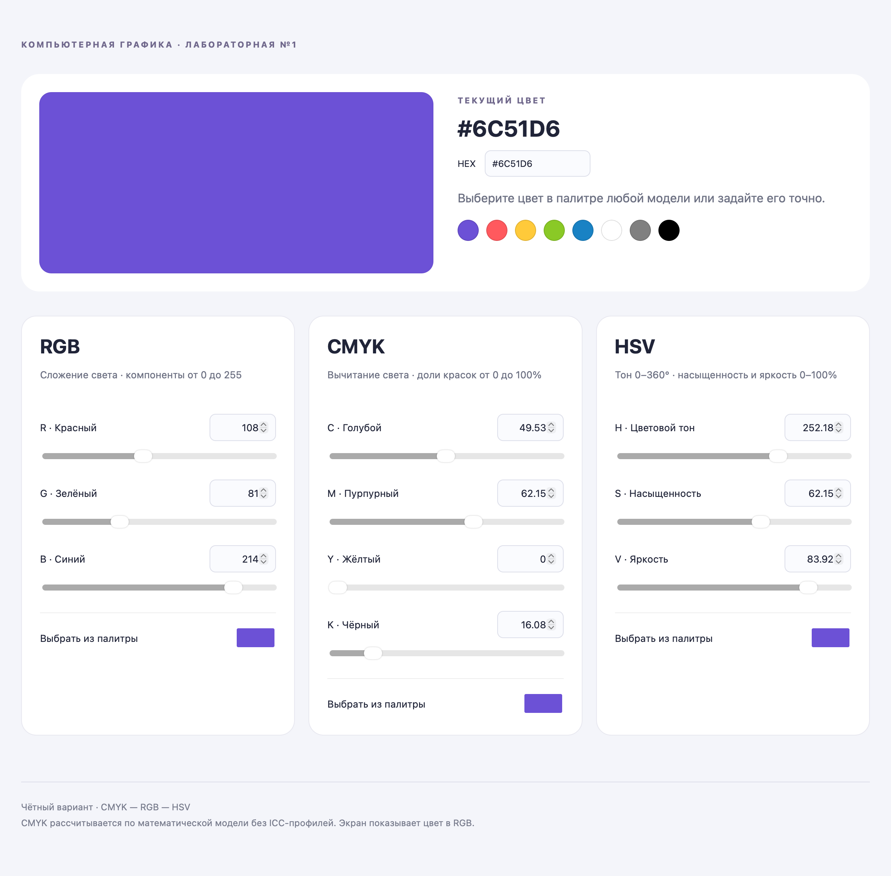
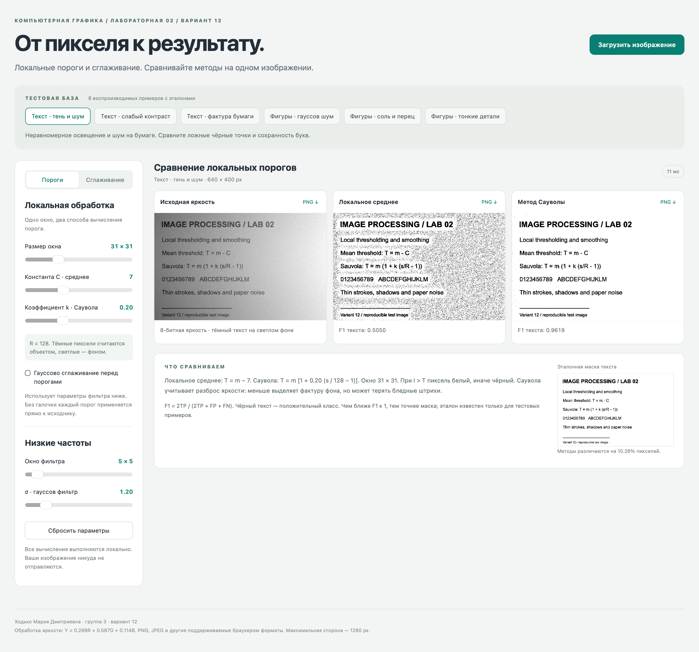

# Компьютерная графика — лабораторные работы

**Ходько Мария Дмитриевна, группа 3.**

Две лабораторные работы с графическим интерфейсом, исходным кодом, тестовыми материалами и отчётами. Приложения работают локально в браузере без установки зависимостей и доступа к интернету.

## Работы

| Работа | Тема и вариант | Приложение | Описание | Отчёт |
| --- | --- | --- | --- | --- |
| №1 | Цветовые модели RGB, CMYK и HSV; чётный вариант | [lab1/index.html](lab1/index.html) | [README](lab1/README.md) | [PDF](lab1/report.pdf) · [LaTeX](lab1/report.tex) |
| №2 | Локальные пороги и сглаживание; вариант 12 | [lab2/index.html](lab2/index.html) | [README](lab2/README.md) | [PDF](lab2/report.pdf) · [LaTeX](lab2/report.tex) |

## Запуск

1. Нажмите **Code → Download ZIP** и распакуйте архив.
2. Для первой работы откройте `lab1/index.html`, для второй — `lab2/index.html`.

Ссылка на HTML в интерфейсе GitHub показывает исходный код. Для запуска приложения скачайте репозиторий и откройте файл в браузере.

Можно клонировать репозиторий:

```bash
git clone https://github.com/immaryllis/cg-color-models-rgb-cmyk-hsv.git
cd cg-color-models-rgb-cmyk-hsv
```

Сервер, Node.js и сборка приложений не требуются.

## Лабораторная №1 — цветовые модели

Числовые поля, ползунки и палитры для RGB, CMYK и HSV; автоматический пересчёт всех моделей при изменении цвета.



## Лабораторная №2 — обработка изображений

- Локальное среднее минус C и метод Сауволы.
- Усредняющий и гауссов сглаживающие фильтры.
- Загрузка своих изображений, настройка параметров, сравнение и сохранение PNG.
- Шесть тестовых примеров с эталонами, оценки F1 и PSNR.
- Формулы, объяснения, результаты экспериментов и скриншоты в отчёте.

[Соответствие условию варианта 12](lab2/REQUIREMENTS.md) · [Тестовая база](lab2/DATASETS.md)



## Технологии

HTML, CSS, JavaScript; алгоритмы реализованы самостоятельно без библиотек обработки изображений. Отчёты подготовлены в LaTeX. Вспомогательные проверки на macOS используют Python, JavaScriptCore и WebKit.
