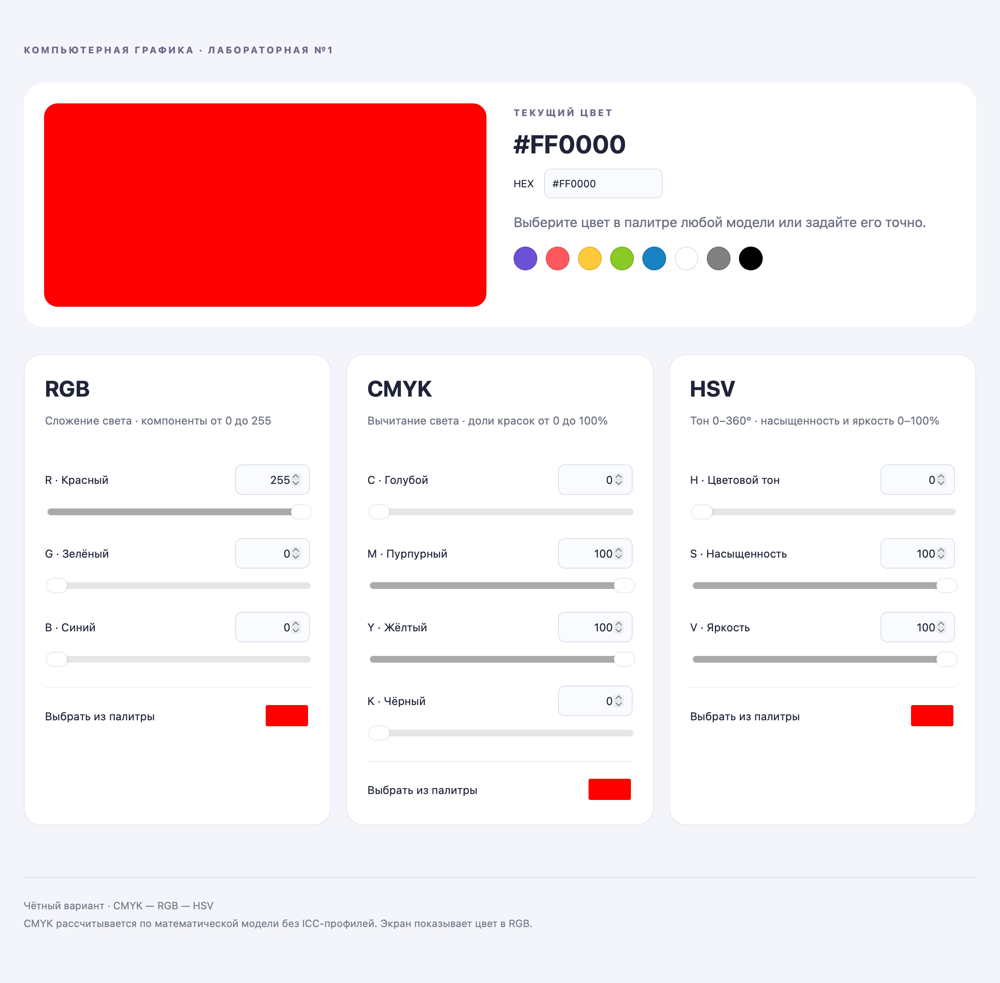
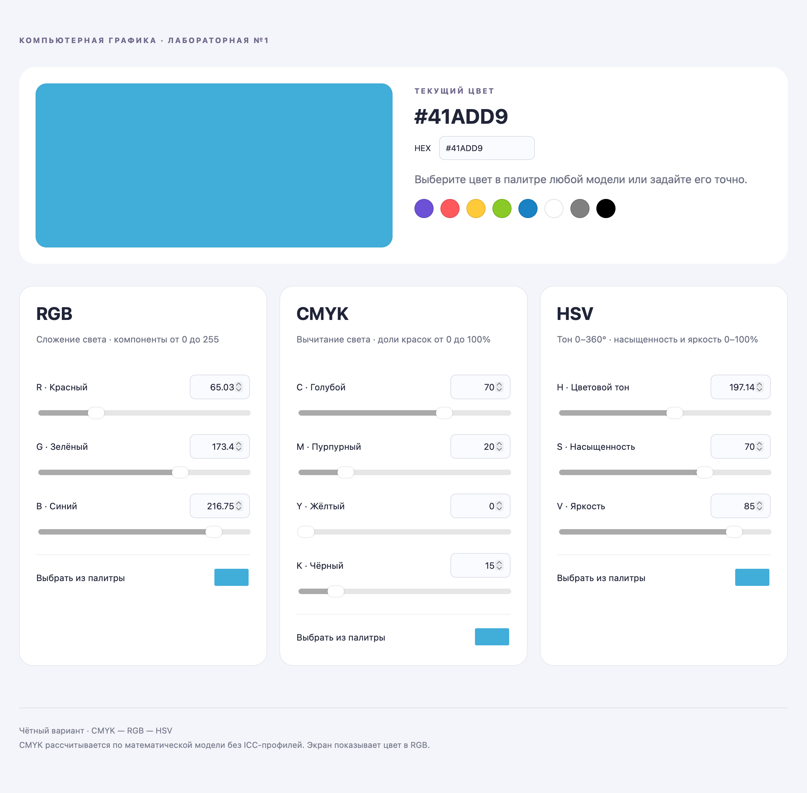
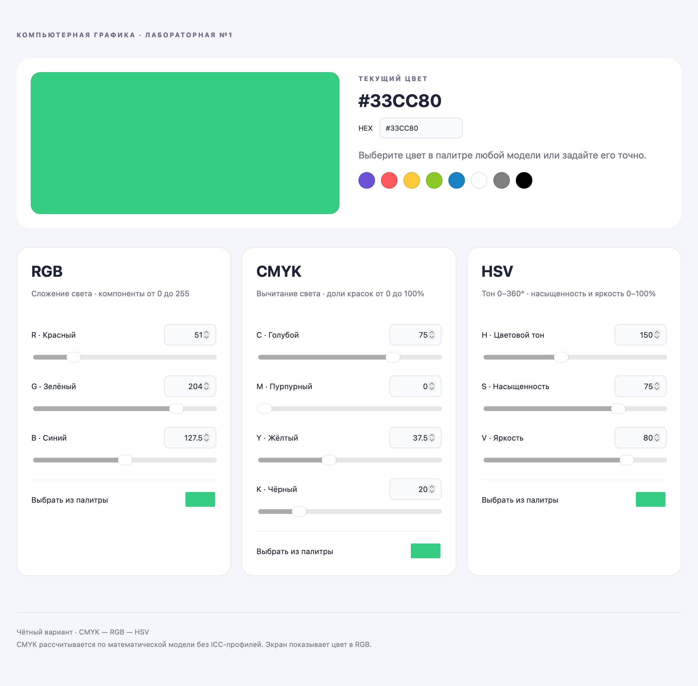

# Лабораторная работа №1. Цветовые модели

**Автор:** Ходько Мария Дмитриевна. **Группа:** 3.

**Чётный вариант:** CMYK — RGB — HSV.

## Задача

Разработать приложение, позволяющее выбрать и интерактивно изменять цвет, одновременно отображая его компоненты в трёх моделях. Обеспечить числовые поля, палитру и ползунки, а также автоматический пересчёт всех представлений.

## Запуск

Откройте `index.html` в современном браузере. Все файлы приложения должны находиться в одной папке. Интернет и установка зависимостей не нужны.

## Компоненты

| Модель | Компоненты | Диапазоны |
| --- | --- | --- |
| RGB | Красный R, зелёный G, синий B | 0–255 |
| CMYK | Голубой C, пурпурный M, жёлтый Y, чёрный K | 0–100% |
| HSV | Тон H, насыщенность S, яркость V | H: 0–360°; S, V: 0–100% |

Каждая панель содержит числовые поля, ползунки и выбор из системной палитры браузера. Выбор из палитры поступает в RGB и пересчитывается в две другие модели.

## Преобразования

В `color.js` реализованы RGB ↔ CMYK и RGB ↔ HSV. Перевод CMYK ↔ HSV выполняется через RGB. Вычисления используют дробные значения; поля отображают до двух знаков после запятой, HEX — целочисленные каналы RGB.

Для чёрного цвета отдельно обработано деление на ноль при переводе в CMYK. Тон ахроматического цвета не влияет на результат; интерфейс сохраняет предыдущий тон. Введённые CMYK-компоненты сохраняются, поскольку одному RGB могут соответствовать разные наборы CMYK. Модель CMYK математическая, без ICC-профилей печати.

## Файлы

| Файл | Назначение |
| --- | --- |
| `index.html` | Структура интерфейса |
| `style.css` | Оформление и адаптивная вёрстка |
| `color.js` | Функции преобразования |
| `app.js` | Состояние, ввод и синхронизация |
| `test_colors.py` | Проверка формул через JavaScriptCore на macOS |
| `report.pdf` | Отчёт со скриншотами |
| `report.tex` | Исходник отчёта LaTeX |
| `screenshots/` | Четыре скриншота приложения |

## Проверка

На macOS с Python 3:

```bash
python3 test_colors.py
```

Проверяются шесть контрольных цветов, 10 000 воспроизводимых наборов RGB, обратные преобразования RGB → CMYK → RGB и RGB → HSV → RGB, а также H = 360°. Допустимое отклонение — 10⁻⁸ на компоненту. Тест использует системный JavaScriptCore macOS и не предназначен для Linux или Windows. Само приложение работает в браузере независимо от ОС.

## Отчёт

[Открыть PDF](report.pdf) · [Исходник LaTeX](report.tex)

Сборка из этой папки: `tectonic report.tex` либо два запуска `xelatex report.tex`. Для Overleaf загрузите `report.tex` вместе с папкой `screenshots` и выберите XeLaTeX.

## Примеры






